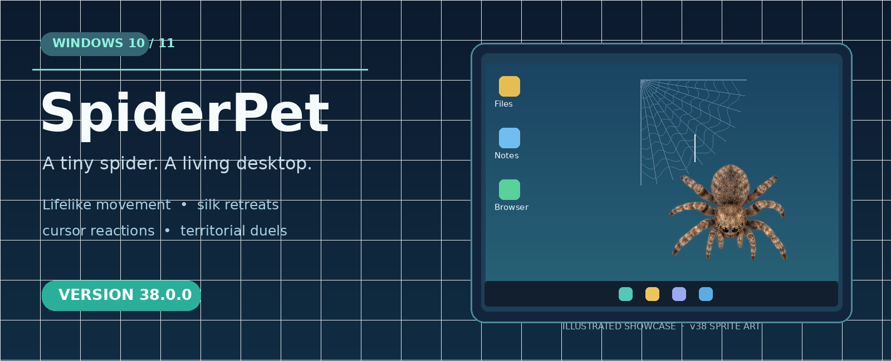
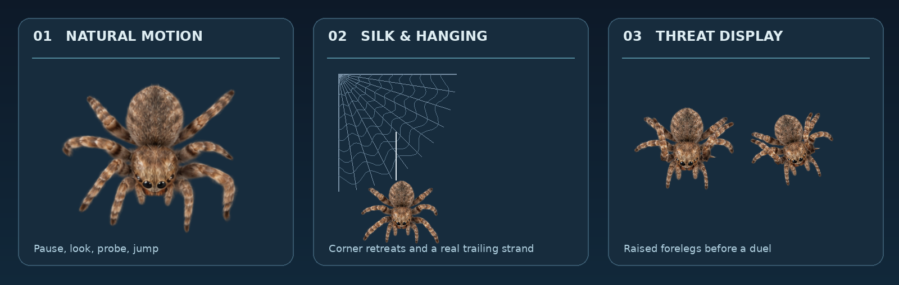

<div align="center">
  

  # SpiderPet 🕷️
  **A lifelike jumping spider that explores your Windows desktop.**

  [](https://github.com/nnnodir3-commits/SpiderPet/releases/latest)
  
  
  [](LICENSE)

  **[⬇️ Download SpiderPet.exe](https://github.com/nnnodir3-commits/SpiderPet/releases/tag/v38.0.0)** · **[Ўзбекча](README_UZ.md)** · **[Report a bug](https://github.com/nnnodir3-commits/SpiderPet/issues/new/choose)**
</div>

> **What's new?** The first public v38 release includes realistic walking, cursor reactions, corner silk retreats, hanging from a visible thread, natural idle behaviors and two-spider territorial encounters.

<div align="center">
  
  <sub>Illustrative composites made with the actual v38 animation sprites; not captured Windows screenshots.</sub>
</div>

## Get SpiderPet

**For most users — no Python required:**

1. Open **[SpiderPet v38.0.0 — Releases](https://github.com/nnnodir3-commits/SpiderPet/releases/tag/v38.0.0)**.
2. Under **Assets**, download **`SpiderPet.exe`** (Windows 10/11).
3. Run the file. The spider moves over your desktop without blocking mouse clicks.
4. Press **`Ctrl + Shift + Q`** to close SpiderPet.

> **Windows security note:** This community project may not have a commercial code-signing certificate. Windows SmartScreen may display a warning for an unfamiliar EXE. Only download from the official release page, and do not bypass security warnings unless you have verified and trust the file and publisher.

## What it can do

| Behavior | What you will see |
| --- | --- |
| 🕷️ Natural movement | Direction-aware walking, turns, jumps and lifelike gait |
| 👀 Curiosity | Stops to look around and probes with its front legs |
| 🖱️ Cursor response | Notices mouse movement, startles or takes a short backward step |
| 🕸️ Silk retreat | Builds a corner shelter; webs can grow and respond to disturbance |
| 🧵 Hanging | Descends and climbs on a visible silk strand — both sprite and silk move together |
| ⚔️ Two-spider encounter | Raised-foreleg displays, territorial clashes and a retreating loser |
| 🪟 Desktop interaction | Moves near application-window edges using a transparent click-through overlay |

The earlier experimental fly-hunting scene **is not included** in v38.

## For developers

Clone the source and install requirements:

```powershell
git clone https://github.com/nnnodir3-commits/SpiderPet.git
cd SpiderPet
py -3 -m pip install -r requirements.txt
py -3 spiderpet.pyw
```

To build a Windows executable locally, run `BUILD_ONE_EXE.bat`. A GitHub Actions workflow is also available under **Actions → Build Windows EXE**; build artifacts are separate from published Releases.

Run tests:

```powershell
py -3 -m unittest discover -p "test_*.py" -v
py -3 check_release_assets.py
```

See [CONTRIBUTING.md](CONTRIBUTING.md), [CHANGELOG.md](CHANGELOG.md), and [SECURITY.md](SECURITY.md). Suggestions, bug reports and pull requests are welcome.

## Licensing and image assets

**Original project code and documentation:** [MIT License](LICENSE).

**Spider PNGs (`walk_*.png`, `threat_*.png`):** *not covered by the code MIT license*. The upstream redistribution terms for the source model and textures have not been independently confirmed. See [ASSETS_LICENSE.md](ASSETS_LICENSE.md) and [asset provenance](docs/ASSET_PROVENANCE.md). Public availability of these files is not itself permission to republish them elsewhere. Contributors should not add unlicensed third-party media.

## Credits

Developed and maintained through [nnnodir3-commits](https://github.com/nnnodir3-commits/SpiderPet).

<div align="center"><sub>SpiderPet v38 · Made for curious Windows desktops</sub></div>
