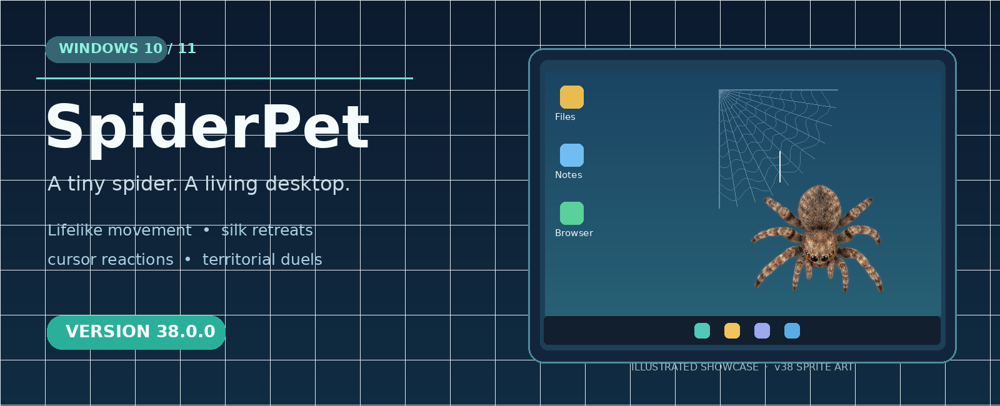
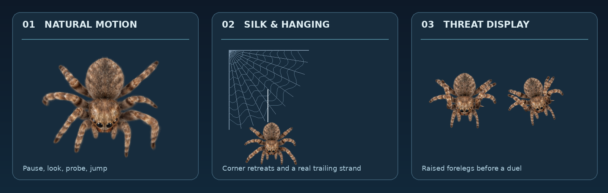

<div align="center">
  

  # SpiderPet 🕷️ — Windows иш столидаги виртуал ўргимчак

  **Табиий ҳаракатланади, уя қуради, ипга осилади ва бошқа ўргимчакларга муносабат билдиради.**

  **[⬇️ SpiderPet.exe ни юклаб олиш](https://github.com/nnnodir3-commits/SpiderPet/releases/tag/v38.0.0)** · **[English README](README.md)**
</div>

<div align="center"><br/><sub>Бу — v38 нинг ҳақиқий PNG анимация кадрларидан тузилган тақдимот. Windows экранининг ҳақиқий скриншоти эмас.</sub></div>

## Дастурни ўрнатиш

1. **[SpiderPet v38.0.0 Releases](https://github.com/nnnodir3-commits/SpiderPet/releases/tag/v38.0.0)** саҳифасини очинг.
2. **Assets** бўлимидан `SpiderPet.exe` ни юклаб олинг.
3. Windows 10 ёки 11 да дастурни ишга туширинг. **Python ўрнатиш шарт эмас.**
4. Чиқиш учун **`Ctrl + Shift + Q`** тугмаларини босинг.

> Дастур ҳозирча тижорий рақамли имзо билан имзоланмаган бўлиши мумкин. Windows хавфсизлик огоҳлантириши чиқса, файлни расмий GitHub релизидан олганингизни ва унга ишонишингизни текширинг.

## SpiderPet v38 имкониятлари

- **Табиий юриш:** сакраш, бурилиш, қадам ҳаракатлари ва фототасвирга асосланган 32 та юриш анимация кадри.
- **Табиий хулқ:** олдинги оёқлар билан пайпаслаш, тўхтаб кузатиш, уяда енгил ҳаракатланиш.
- **Курсорга реакция:** сезиш, чўчиш ва қисқа орқага чекиниш.
- **Ипак уя:** экран бурчакларида уя қуриш, уянинг ўсиши ва бузилиши.
- **Ипга осилиш:** ўргимчакнинг пастга тушиши ва қайтиб кўтарилиши; ип тана ҳаракати билан бирга кўринади.
- **Икки ўргимчак:** олдинги оёқларини кўтариб куч намойиши, жанжал ва мағлубнинг қочиши.
- **Дастур ойнаси четлари:** экрандаги очиқ ойналар чегараси бўйлаб ҳаракат қилиш.

Пашша овлаш бўйича тажриба **v38 версиясига киритилмаган**.

## Дастурчилар учун

```powershell
git clone https://github.com/nnnodir3-commits/SpiderPet.git
cd SpiderPet
py -3 -m pip install -r requirements.txt
py -3 spiderpet.pyw
```

Тестларни ишга тушириш:

```powershell
py -3 -m unittest discover -p "test_*.py" -v
py -3 check_release_assets.py
```

Windows EXE йиғиш учун `BUILD_ONE_EXE.bat` файлидан ёки GitHub Actions'дан фойдаланиш мумкин. Таклифлар ва хатолик хабарларини [Issues](https://github.com/nnnodir3-commits/SpiderPet/issues) бўлимига юборишингиз мумкин.

## Лицензия ва график ресурслар

**Дастурнинг асл коди ва ҳужжатлари — [MIT](LICENSE).**

**44 та PNG анимация кадри MIT лицензиясига кирмайди.** Асл модель ва текстуралар асосида яратилган тасвирларни қайта тарқатиш шартлари мустақил тасдиқланмаган. `ASSETS_LICENSE.md` ва `docs/ASSET_PROVENANCE.md` ни ўқинг. GitHub'да кўриниб туриши уларни бошқа лойиҳаларда эркин қайта тарқатишга рухсат дегани эмас.

**Лойиҳа:** [nnnodir3-commits/SpiderPet](https://github.com/nnnodir3-commits/SpiderPet)
